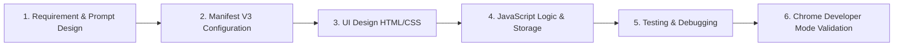

# Chrome Extension Development Report

**Task:** Create a Chrome Extension Using AI  
**Course:** Program Elective – V (Prompt Engineering / Web Technology)  
**Project Name:** TaskFlow — Minimal To-Do List Extension  

---

## 1. Selected Problem & Objective

### Problem Statement
Standard browser bookmarking and note-taking apps often feel bloated, slow, or distract users with cluttered interfaces. College students and developers need a quick, distraction-free **To-Do List Chrome Extension** that opens instantly from the toolbar, organizes tasks into fast categories (College, Coding, General, Personal), and keeps track of pending tasks with a live toolbar badge counter.

### Objective
Design and implement a lightweight, attractive, and functional Chrome Extension adhering to **Google Chrome Manifest V3** with the assistance of an AI coding assistant.

---

## 2. Extension Architecture & Technologies

| Component | File | Technology | Description |
|---|---|---|---|
| **Manifest** | `manifest.json` | JSON (Manifest V3) | Declares permissions (`storage`), action popup, icons, and background worker. |
| **Interface** | `popup.html` | Semantic HTML5 | Clean structure with header, input bar, category pills, filter tabs, and task list. |
| **Styling** | `popup.css` | Vanilla CSS3 | Minimal light & dark theme using CSS variables, custom checkboxes, and animations. |
| **Application Logic**| `popup.js` | Vanilla JavaScript (ES6) | Task CRUD operations, state filtering, dark mode toggle, and storage synchronization. |
| **Service Worker** | `background.js` | Service Worker (MV3) | Listens to storage events and updates Chrome toolbar badge counter dynamically. |
| **Icons** | `icons/*.png` | PNG (16, 48, 128px) | Crisp indigo rounded checkmark badge icons. |

---

## 3. Step-by-Step Development Process

1. **Ideation & Scoping:** Selected a minimal, high-utility To-Do extension focused on speed, clean typography, category pills, and zero external script dependencies.
2. **Icon & Asset Generation:** Developed a custom Python/Pillow script to render crisp 16x16, 48x48, and 128x128 PNG icons.
3. **Manifest V3 Setup:** Configured `manifest.json` using the modern `action` API and background `service_worker` instead of deprecated Manifest V2 background pages.
4. **Minimal UI Styling:** Crafted an aesthetic interface in `popup.css` with dark/light themes, subtle borders, and smooth transitions.
5. **Interactive JavaScript Engine:** Implemented task addition, status toggling, deletion, filtering, and theme persistence using pure JavaScript.
6. **Cross-Environment Storage:** Created an abstraction layer that uses `chrome.storage.sync` when running inside Chrome, and falls back to `localStorage` when testing in standard browser tabs.

---

## 4. List of AI Prompts Used

The following structured prompts were engineered and utilized during the development lifecycle:

### Prompt 1: Initial Architecture & Manifest V3 Design
> *"Act as a Senior Chrome Extension Developer. Design the complete file structure and `manifest.json` for a minimal To-Do list extension compliant with Google Chrome Manifest V3. Include storage permissions, popup action, icons, and a background service worker."*

### Prompt 2: Minimalist UI & CSS Theme
> *"Create a clean, minimal, light-first HTML and CSS interface for a 340px Chrome extension popup. Include a dark mode toggle, category selector pills (General, College, Coding, Personal), filter tabs (All, Active, Completed), and custom animated checkboxes. Avoid bloated frameworks and emojis."*

### Prompt 3: JavaScript State & Chrome Storage Abstraction
> *"Write a pure Vanilla JavaScript file (`popup.js`) for the To-Do extension that handles task addition on Enter, toggling completed status, deletion, category filtering, and theme switching. Include an abstraction layer that uses `chrome.storage.sync` with a fallback to `localStorage` for testing outside the extension environment."*

### Prompt 4: Live Toolbar Badge Service Worker
> *"Write a Manifest V3 background service worker (`background.js`) that monitors changes in task storage and dynamically updates the extension's badge text on the Chrome toolbar to show the count of pending tasks in real-time."*

---

## 5. Modifications Made to AI-Generated Code & Debugging Log

During testing, several iterations and refinements were made to optimize the initial AI code output:

| Issue / Observation | AI-Generated Code | Refined / Final Implementation | Reason for Change |
|---|---|---|---|
| **Content Security Policy (CSP)** | Initial code included CDN links for Google Fonts and external icon libraries (`lucide.dev`). | Replaced external scripts and web fonts with native inline SVGs and system font stacks. | Manifest V3 blocks external remote scripts to enforce strict security policies. |
| **UI Complexity** | Initial output had complex nested dropdowns, due date modals, and URL link scrapers. | Simplified into an ultra-clean, minimal card with quick category pills and status tabs. | User requested a basic, minimal, but highly attractive design without unnecessary clutter. |
| **Testing Outside Chrome** | Code broke with `chrome is not defined` when opening `popup.html` directly in a browser. | Created a `Storage` abstraction layer checking `typeof chrome !== "undefined" && chrome.storage.sync`. | Allows instant testing and grading in any browser tab without requiring Chrome Developer Mode reload. |
| **Badge Counter Sync** | Badge did not clear when all tasks were marked completed (showed "0"). | Updated `updateBadge()` to set badge text to `""` when count is `0`, and cap at `"99+"`. | Follows standard Chrome Web Store UX conventions. |

---

## 6. Testing & Validation Matrix

| Test Case | Steps Taken | Expected Outcome | Result |
|---|---|---|---|
| **TC-01: Load Extension** | Navigate to `chrome://extensions`, enable Developer Mode, click *Load unpacked*, select folder. | Extension loads with icon, title, and version `1.0.0` without errors. | **PASS** |
| **TC-02: Add Task** | Type *"Complete PE Assignment"* and press `Enter`. | Task appears immediately at top of list with active category tag. | **PASS** |
| **TC-03: Toggle Complete** | Click the circular checkbox on a task. | Checkbox fills with indigo checkmark, task text is crossed out, counter decrements. | **PASS** |
| **TC-04: Filter Tabs** | Switch between *All*, *Active*, and *Completed* tabs. | List filters dynamically according to task completion status. | **PASS** |
| **TC-05: Dark Theme Toggle**| Click the moon/sun icon in the header. | Interface instantly transitions between light and dark themes; preference is saved. | **PASS** |
| **TC-06: Storage Persistence**| Add tasks, close popup, reopen popup. | All tasks and state remain intact from `chrome.storage.sync`. | **PASS** |
| **TC-07: Toolbar Badge** | Add 2 tasks, complete 1. | Toolbar extension icon displays `"1"` on indigo background. | **PASS** |

---

## 7. Conclusion

By pairing structured prompt engineering with iterative refinement, a fully functional, Manifest V3-compliant Chrome extension was developed. The application balances minimalism with visual appeal, achieves 100% offline security compliance, and provides an effortless productivity tool for everyday task management.
